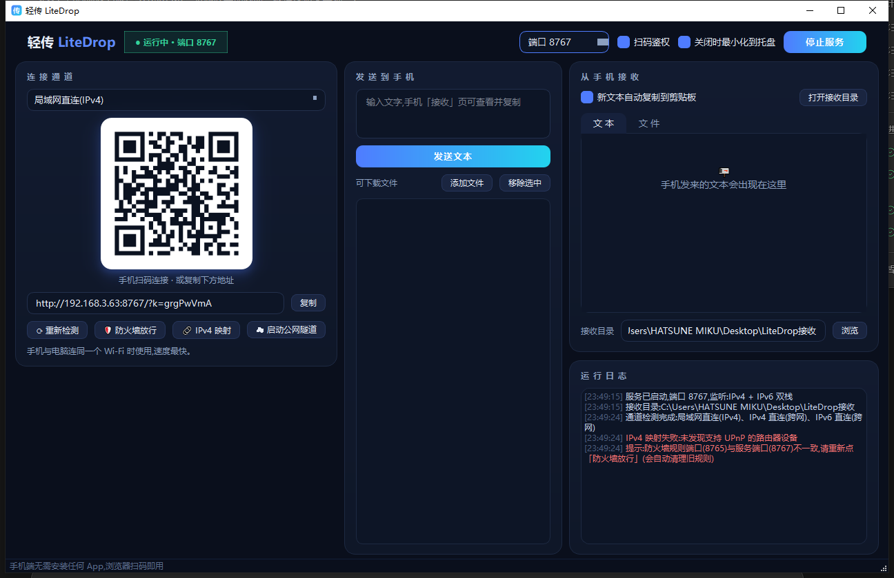
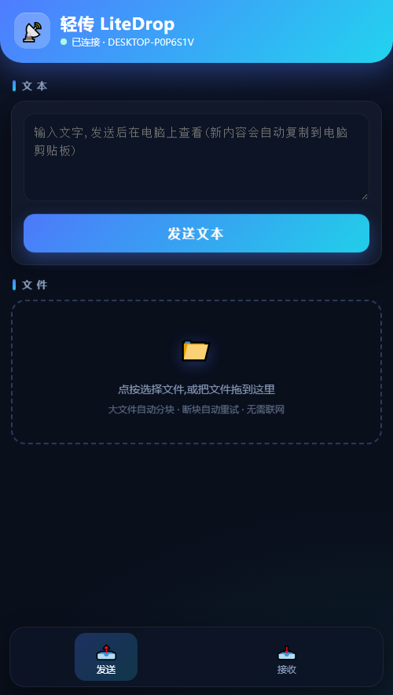
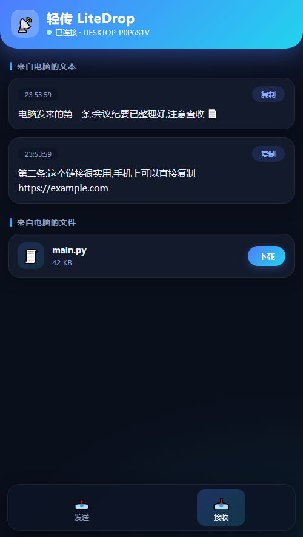

# 轻传 LiteDrop

手机 ↔ 电脑 互传文件与文本的轻量工具。PC 端运行一个小程序,手机端**扫码用浏览器打开**即可,手机无需安装任何 App。

| 电脑端 | 手机端(发送 / 接收) |
|---|---|
|  |   |


## 功能

- **手机 → 电脑**:发文本(到达即显示,可自动复制到电脑剪贴板)、传文件(多选、大文件自动分块、进度条、断块自动重试)
- **电脑 → 手机**:推送文本(手机上一键复制)、把文件挂到可下载列表(手机点击下载)
- **四种连接通道**,界面下拉切换、二维码随通道自动生成:

| 通道 | 适用场景 | 说明 |
|---|---|---|
| 局域网直连(IPv4) | 同一 Wi-Fi(默认) | 速度最快,零配置 |
| 手机热点直连 | 电脑连接手机热点 | 手机就是网关,扫码即用,**不要求手机能上网** |
| IPv4 直连(跨网) | 手机流量 / 不同 Wi-Fi | 程序自动通过 UPnP 在路由器建立端口映射,要求宽带为公网 IPv4(非 CGNAT) |
| IPv6 直连(跨网) | 手机流量 / 不同 Wi-Fi | 零第三方、端到端,要求双方都有公网 IPv6 |
| 公网隧道 | 上者不通时的兜底 | 一键拉起 cloudflared 免注册隧道,走 Cloudflare 中转,HTTPS,速度较慢 |
| Tailscale | 保底 | 两端登录同一 Tailscale 账号后自动出现在通道列表 |

## 快速开始

```bash
pip install -r requirements.txt   # 或手动: pip install PySide6 qrcode
python main.py
```

启动后服务自动运行:用手机(连同一 Wi-Fi)扫描二维码 → 浏览器打开页面 → 互传。

**打包为单文件 exe**(约 50MB,双击即用,无需 Python):

```bash
build_exe.bat        # 产物在 dist\LiteDrop.exe
```

## 各通道使用要点

### 局域网直连
手机与电脑连同一个 Wi-Fi,扫「局域网直连」的二维码即可。

### 手机热点直连
1. 手机开热点,电脑连上该热点 Wi-Fi(USB 数据线共享网络同样支持);
2. 程序自动识别热点网络并显示「手机热点直连」通道,手机直接扫码;
3. 此方式**不要求手机能上网**(热点不开流量也能传);电脑此时无互联网属正常,恢复原 Wi-Fi 后点「重新检测」即可。

### IPv4 直连(跨网)
1. 启动服务后程序自动探测公网 IPv4 并尝试 UPnP 端口映射(日志显示结果);
2. 手机**关 Wi-Fi 用流量**,扫「IPv4 直连(跨网)」的二维码;
3. 注意:宽带重拨后公网 IP 会变,点「重新检测」刷新即可;程序退出/停止服务时会自动删除映射;
4. 若日志提示映射失败:多数是路由器 UPnP 开关未开(华为路由器在「更多功能 → 网络设置 → UPnP」),可开启后点「IPv4 映射」重试,或在路由器后台手动把 TCP 端口转发到本机 IP。

### IPv6 直连(跨网推荐)
1. 点一次「防火墙放行」(弹出 UAC 请允许,只需一次);
2. 手机**关闭 Wi-Fi 用流量**,扫「IPv6 直连(跨网)」的二维码;
3. 打不开时:手机浏览器访问 test-ipv6.com 确认手机有 IPv6;家用路由器的 IPv6 防火墙若拦截入站,需在路由器后台放行,或改用隧道。

### 公网隧道(兜底)
点「启动公网隧道」,程序自动准备 cloudflared 并生成 `https://xxx.trycloudflare.com` 地址与二维码。注意:
- 首次会从 GitHub 下载 cloudflared(约 20MB),国内较慢;也可手动下载 [cloudflared-windows-amd64.exe](https://github.com/cloudflare/cloudflared/releases/latest/download/cloudflared-windows-amd64.exe) 保存到 `C:\Users\<你>\.litedrop\cloudflared.exe` 后重试;
- 国内访问 trycloudflare.com 的速度不稳定,适合应急。

### Tailscale(保底)
电脑与手机都安装 [Tailscale](https://tailscale.com) 并登录同一账号,重启本程序后通道列表会自动出现「Tailscale」。

## 安全说明

- 每次安装后生成随机 8 位访问口令,含在二维码里;**口令在服务重启后保持不变**(保存在本机),手机上的历史标签页不会因重启失效。未持口令的请求一律 403,并限速防爆破。顶栏可关闭「扫码鉴权」(不建议)。
- 电脑→手机的下载只允许清单内的文件,无路径穿越风险。
- 局域网 / IPv6 直连为 HTTP 明文,仅限可信网络使用;公网隧道全程 HTTPS,但中转方(Cloudflare)技术上可见内容——**敏感文件请优先走直连或 Tailscale**。
- **IPv4 跨网直连会把端口暴露到公网**:仅靠随机口令保护(无口令请求一律 403 并限速),口令在二维码里,不要把带口令的连接地址发给不信任的人。停止服务或退出程序时端口映射会自动删除。
- 传输历史(文本)仅保留最近 50 条,重启即清空。

## 目录与文件

| 文件 | 用途 |
|---|---|
| `main.py` | PySide6 界面主程序 |
| `server.py` | HTTP 服务(纯标准库,IPv4/IPv6 双栈,分块上传) |
| `channels.py` | 通道检测、cloudflared 管理、防火墙放行 |
| `mobile_page.py` | 手机端页面(内嵌单文件) |
| `test_server.py` | 接口自动化测试(22 项) |
| `build_exe.bat` | 一键打包脚本 |

接收文件默认保存在 `桌面\LiteDrop接收`,可在界面修改。上传的临时分片存于接收目录 `.uploads\` 下,完成后自动清理,异常残留 24 小时后自动清除。

## 常见问题

| 现象 | 处理 |
|---|---|
| 手机打不开页面 | 确认服务「运行中」;同一 Wi-Fi;路由器开了 AP 隔离则关闭 |
| 首次启动后手机连不上局域网 | 点「防火墙放行」,或 Windows 防火墙里允许 LiteDrop(专用网络)。改过端口后请再点一次(程序会自动清理旧端口规则) |
| 端口被占用 | 顶栏改端口,服务会自动重启 |
| 提示「口令无效」 | 新版口令在重启后保持不变;若手机上保留了旧标签页/历史链接,请重新扫码打开 |
| IPv6 直连不通 | 手机浏览器打开 test-ipv6.com 确认有 IPv6;点「防火墙放行」;路由器「IPv6 防火墙」放行(华为:更多功能 → 网络设置 → IPv6 防火墙,关闭或添加放行本端口 TCP 的规则) |
| 隧道打不开或提示 Method Not Allowed | 隧道地址每次启动都会变,旧二维码/旧地址会失效;新版程序会先自检再显示隧道入口,隧道意外退出会自动重启。停止隧道后重新点「启动公网隧道」并扫新码 |
| 隧道启动失败 | 手动放置 cloudflared.exe(见上文路径)后重试 |
